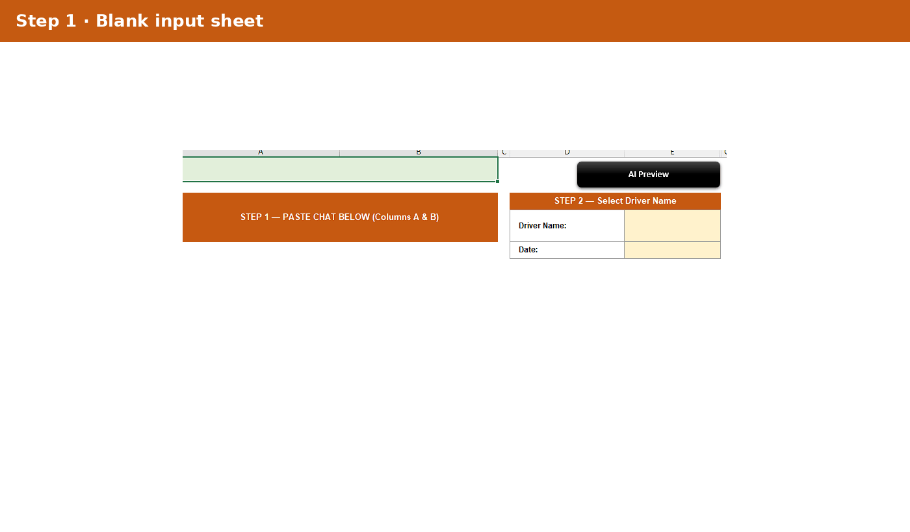
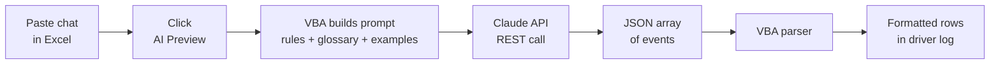
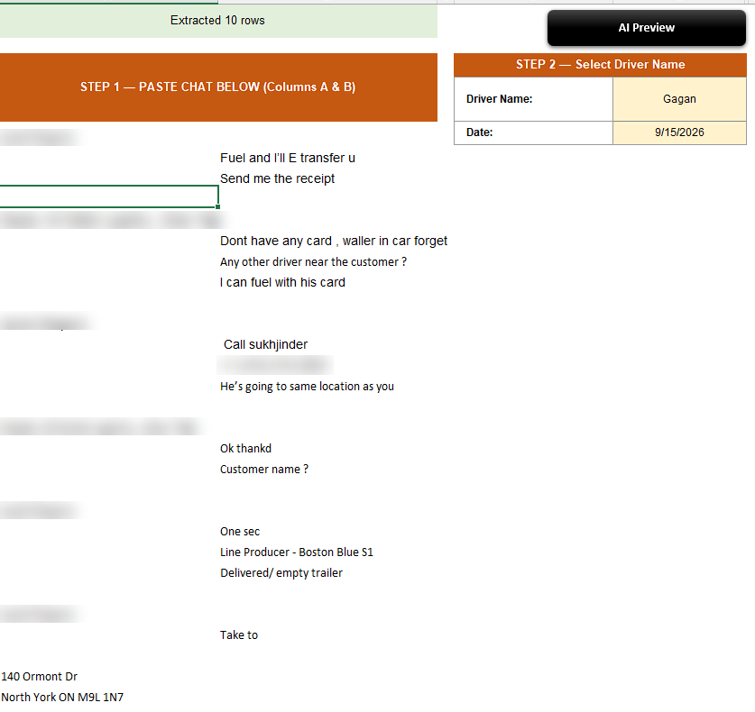
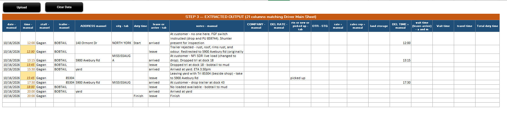
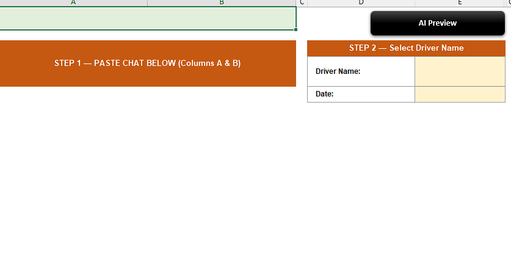
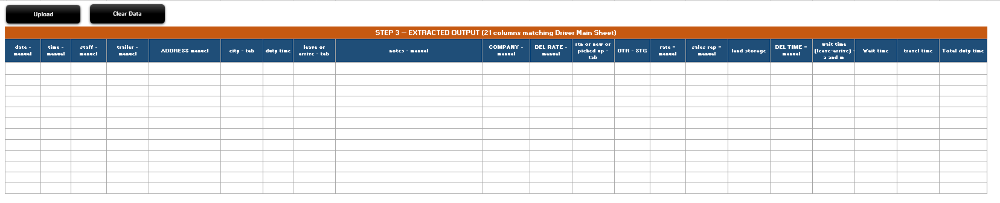

# Excel AI Chat Insights

### An Excel VBA tool that sends messy driver ↔ dispatcher chats to the Claude API and gets back a clean, dispatch-ready event log in one click: times, trailers, addresses, cities and notes.




---

## 📑 Table of Contents

- [Project Overview](#-project-overview)
- [Business Problem](#-business-problem)
- [How It Works](#️-how-it-works)
- [Screenshots](#-screenshots)
- [Extraction Rules](#-extraction-rules)
- [Key Features & Design Decisions](#-key-features--design-decisions)
- [Technical Approach](#-technical-approach)
- [VBA Modules](#-vba-modules)
- [Setup](#-setup)
- [Repository Structure](#-repository-structure)
- [Skills Demonstrated](#-skills-demonstrated)
- [Related Project](#-related-project)
- [Contact](#-contact)

---

## 📌 Project Overview

Built for a Canadian trucking company whose dispatchers coordinate drivers over text chat. Every day someone had to read those chats and type each pickup, drop and trailer switch into the driver log by hand. This tool does it with one button: **paste chat → AI Preview → structured rows**.

| Item | Detail |
|---|---|
| 💬 Input | Raw driver ↔ dispatcher chat pasted into Excel |
| 🤖 AI model | Claude (Anthropic API), temperature 0 for consistent output |
| 📤 Output | One row per driver event, written into a 21-column driver-log layout |
| 🧾 Fields extracted | Time, trailer, address, city, leave / arrived, notes, return / new / picked up, delivery time |
| ⏱️ Run time | About 10–30 seconds per chat |
| 💻 Platforms | Excel for Windows and Excel for Mac |

> **Note:** this is a demo version. The API key is removed and screenshots have personal details blurred.

---

## 🎯 Business Problem

Dispatch chats are short, informal and full of shorthand ("Drop and pu 859744", "bobtail to mud", "ETA 1:15pm"). Turning them into a log took hours each week and mistakes crept in.

**Questions the tool answers for every chat:**

1. Where did the driver go, in what order, and **when** did they arrive and leave?
2. Which **trailer** were they pulling on each leg, and when were they running empty (**BOBTAIL**)?
3. Which stops were **cancelled or redirected** before the driver got there?
4. What happened at each stop (live load, rejected trailer, switch), in plain notes?
5. When did the driver's day **finish**?

---

## ⚙️ How It Works



1. Paste the chat into columns A–B of the **AI Extract** sheet and pick the driver name.
2. Click **AI Preview**.
3. VBA builds a detailed prompt: extraction rules, the trucking **Glossary** sheet and worked examples.
4. The prompt is sent to the Claude API (MSXML on Windows, curl on Mac).
5. Claude returns a JSON array, one object per event.
6. A custom VBA parser turns the JSON into rows and writes them into the output table. AI-estimated times are highlighted so the dispatcher can check them.

---

## 🖼️ Screenshots

### 1️⃣ Input: paste the chat and select the driver



### 2️⃣ Output: AI-generated event log



- Each driver event becomes one row: **date, time, staff, trailer, address, city, leave / arrived, notes**
- Times the AI **inferred** (not stated in the chat) are shaded yellow and italic
- The first row is marked **Start** and the last row **Finish** automatically
- Company and rate columns are filled by lookup from the main driver sheet

<details>
<summary>Blank input and output templates</summary>




</details>

---

## 📏 Extraction Rules

The prompt gives the model strict rules so output is consistent:

| Rule | What it does |
|---|---|
| **Every time filled** | Times come from the chat (ETAs, timestamps). If missing, they are inferred: leave = arrive + 15 min, bobtail after delivery = arrive + 30 min |
| **Never the clock time** | The model may not use the current time; only the chat content |
| **Redirects** | If the dispatcher changes the destination before the driver arrives, no "arrived" row is created for the old stop |
| **BOBTAIL tracking** | The model tracks the current trailer; after a drop with no pickup, the next legs show BOBTAIL |
| **Finish row** | Last row is always Finish: same time as the last event if at the yard, otherwise +15 min |
| **Rich notes** | Notes read like a dispatcher's logbook: customer codes, rejections, switches, reasons |
| **JSON only** | The model returns only a JSON array, so parsing is reliable |

---

## ✨ Key Features & Design Decisions

| Feature | Why |
|---|---|
| 🖱️ **One-button workflow** | Dispatchers stay in Excel; no new app to learn |
| ⚙️ **Settings sheet** | Model, API key, timeouts, retries and behaviour switches are edited in a sheet, not in code |
| 📖 **Glossary sheet** | Company shorthand (yards, customer codes, slang) is fed into every prompt, so the business can teach the AI new terms without touching VBA |
| 🧠 **Few-shot examples** | Worked examples with reasoning show the model exactly how to handle redirects, rejections and switches |
| 🟨 **Inferred times highlighted** | The AI's guesses are visible, so a human checks them before saving |
| 🔁 **Retries + clear errors** | Failed calls retry automatically; errors show a plain message |
| 🍎 **Windows and Mac** | Detects the OS at runtime and uses the right HTTP method |
| 🔤 **Auto-formatting** | Cities and trailer numbers uppercased to match the existing log |

---

## 🧮 Technical Approach

| Area | What was built |
|---|---|
| **Prompt engineering** | Role, context, output schema, absolute rules, time logic, trailer logic, notes guidance, glossary and worked examples assembled in VBA |
| **REST API from VBA** | JSON payload built by hand and sent with `MSXML2.ServerXMLHTTP` (Windows) or `curl` via AppleScript (Mac), with timeouts and retries |
| **Unicode-safe JSON** | Custom JSON encoder and UTF-8 byte writer so non-English characters survive the round trip |
| **JSON parser** | State-machine parser that extracts the model's text, strips code fences, matches braces and reads each field with escape handling |
| **Excel output** | Writes into a fixed 21-column layout, applies formatting rules, adds Start / Finish and lookup formulas |

---

## 🧩 VBA Modules

| Module | Purpose |
|---|---|
| [`AIExtract_Mod1.bas`](vba/AIExtract_Mod1.bas) | API layer: `CallClaudeAPI`, Windows and Mac HTTP calls, JSON encoder, settings reader |
| [`AIExtract_Mod2.bas`](vba/AIExtract_Mod2.bas) | Prompt builder: rules, time / trailer / notes logic, glossary and worked examples |
| [`AIExtract_Mod3.bas`](vba/AIExtract_Mod3.bas) | Response parser: extracts and cleans the JSON, returns a 2D array of events |
| [`AIExtract_Mod4.bas`](vba/AIExtract_Mod4.bas) | Main macro `AIPreview_Automation`: validates input, calls the API, writes and formats the output |

---

## 🚀 Setup

1. Download [`workbook/Excel_AI_Chat_Summarizer_Demo.xlsm`](workbook/Excel_AI_Chat_Summarizer_Demo.xlsm) and enable macros.
2. Open the **Settings** sheet and paste your Anthropic API key into **Anthropic API Key**.
3. On the **AI Extract** sheet, paste a chat into columns A–B and select a driver name.
4. Click **AI Preview** and wait 10–30 seconds.

> Never commit a workbook with a real API key in it.

---

## 📁 Repository Structure

```
📦 excel-ai-chat-insights
 ┣ 📜 README.md
 ┣ 📂 workbook
 ┃ ┗ 📗 Excel_AI_Chat_Summarizer_Demo.xlsm   # Demo workbook (no API key)
 ┣ 📂 vba
 ┃ ┣ 📄 AIExtract_Mod1.bas                   # API calls + settings
 ┃ ┣ 📄 AIExtract_Mod2.bas                   # Prompt builder
 ┃ ┣ 📄 AIExtract_Mod3.bas                   # JSON parser
 ┃ ┗ 📄 AIExtract_Mod4.bas                   # Main macro
 ┗ 📂 images
   ┣ 🎞️ demo.gif
   ┣ 🖼️ 01_input_blank.png
   ┣ 🖼️ 02_input_with_chat.png
   ┣ 🖼️ 03_output_blank.png
   ┗ 🖼️ 04_output_after_ai.png
```

---

## 🧠 Skills Demonstrated

- **Generative AI integration**: calling the Claude API directly from Excel
- **Prompt engineering**: rules, schema, glossary and few-shot examples for reliable structured output
- **Advanced VBA**: REST calls, JSON encoding and parsing, UTF-8 handling, cross-platform code
- **Business process automation**: replacing manual log entry with a one-click flow
- **User-centred design**: settings sheet, glossary sheet, highlighted AI guesses, clear error messages

---

## 🔗 Related Project

The chat extraction module (Microsoft 365 sign-in and Teams chat export) is here: [excel-vba-teams-chat-extractor](https://github.com/mdatafinnovatics/excel-vba-teams-chat-extractor)

---

## 📬 Contact

**Pradeep Kumar** | Founder, Mdata Finnovatics | Excel VBA, Power BI & AI Automation Consultant

[](https://mdatafinnovatics.com)
[](https://www.linkedin.com/in/pradeepkumar777)

---

⭐ **If you found this project useful, please give it a star!** ⭐
